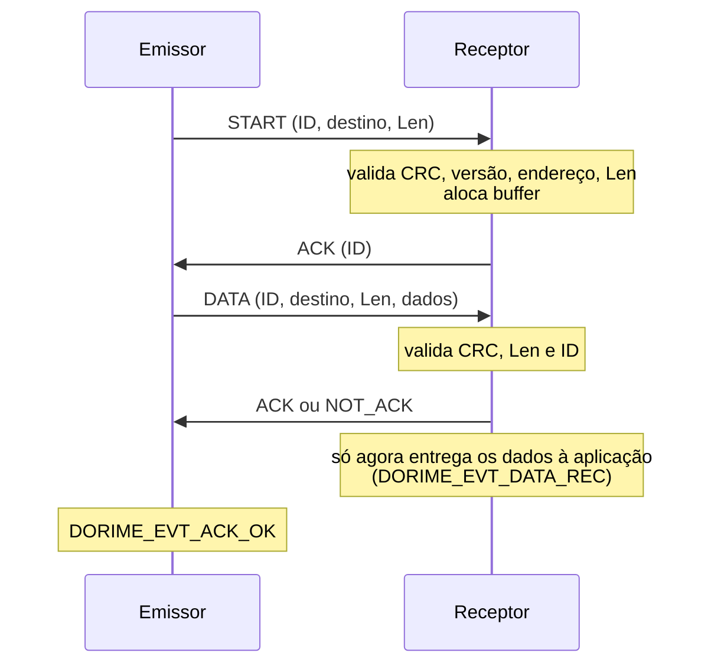
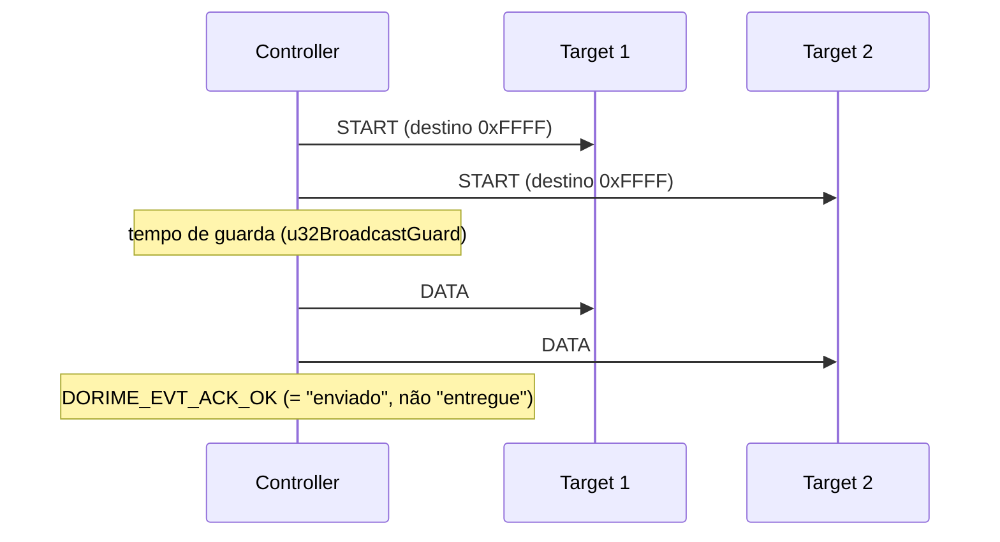
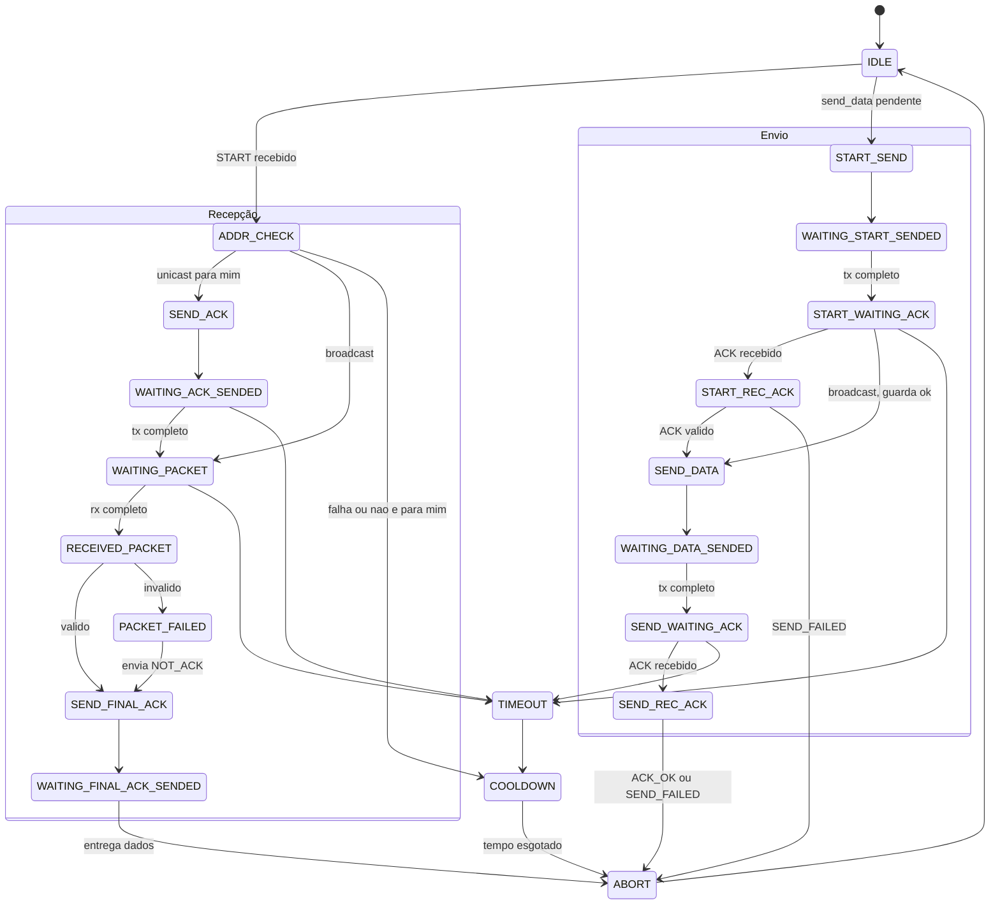

# Dorime Serial Protocol


Biblioteca em C para comunicação **half-duplex** entre um dispositivo mestre (*Controller*) e vários escravos (*Targets*), baseada em **máquina de estados** e independente de hardware. Foi pensada para enlaces como **RF 433 MHz**, **RS485** e qualquer outro meio compartilhado em que só um dispositivo fala por vez.

- Versão do protocolo: **1.0** (`DORIME_VERSION_MAJOR = 1`, `DORIME_VERSION_MINOR = 0`)
- Linguagem: C99, sem dependência de RTOS
- Arquivos: `dorime-sp.h`, `dorime-sp.c`, `dorime-sp-interface.h` (+ opcionalmente `crc32.h/.c`)

---

## Sumário

1. [Visão geral](#1-visão-geral)
2. [Quando usar (e quando não usar)](#2-quando-usar-e-quando-não-usar)
3. [Conceitos](#3-conceitos)
4. [Formato dos pacotes](#4-formato-dos-pacotes)
5. [Transações](#5-transações)
6. [Máquina de estados](#6-máquina-de-estados)
7. [Integração no projeto](#7-integração-no-projeto)
8. [Referência da API](#8-referência-da-api)
9. [O *port*: contrato com o hardware](#9-o-port-contrato-com-o-hardware)
10. [Exemplo completo (STM32 HAL + RS485)](#10-exemplo-completo-stm32-hal--rs485)
11. [Padrões de uso](#11-padrões-de-uso)
12. [Dimensionando os timeouts](#12-dimensionando-os-timeouts)
13. [Pontos de atenção](#13-pontos-de-atenção)
14. [Limitações conhecidas](#14-limitações-conhecidas)
15. [Diagnóstico e depuração](#15-diagnóstico-e-depuração)
16. [Migração a partir da versão anterior](#16-migração-a-partir-da-versão-anterior)
17. [Validação realizada](#17-validação-realizada)

---

## 1. Visão geral

A biblioteca resolve o problema de transportar **blocos de dados confiáveis** (com endereçamento, verificação de integridade e confirmação) sobre um canal serial simples. O que ela entrega:

| Recurso | Descrição |
|---|---|
| Endereçamento | 1 Controller (`0x0000`), até 65 534 Targets (`0x0001`–`0xFFFE`) e broadcast (`0xFFFF`) |
| Integridade | CRC-32 sobre cabeçalho + dados, marcador de fim (*tail*) e checagem de versão |
| Confirmação | Handshake de duas fases (START/ACK e DATA/ACK) em transmissões unicast |
| Broadcast | Envio sem confirmação, com tempo de guarda entre START e DATA |
| Timeouts | Por etapa da transação, com parcela proporcional ao tamanho do dado |
| Recuperação | *Cooldown* após falhas, para o dispositivo não interpretar o meio ocupado como lixo |
| Multi-instância | Tudo vive em uma struct `dorime_t`; é possível ter várias instâncias (ex.: uma em RF e outra em RS485) |
| Portabilidade | Hardware acessado só por ponteiros de função (`tx`, `rx`, `dir`, `abort`, contador de tempo) |
| Memória | Buffer de dados alocado por transação (alocador próprio opcional) |

Princípio de funcionamento: **toda mudança de estado ocorre dentro de `dorime_handler()`**. As interrupções do hardware apenas sinalizam eventos (`dorime_tx_event()` e `dorime_rx_event()` setam flags), o que elimina condições de corrida entre ISR e laço principal.

---

## 2. Quando usar (e quando não usar)

### Casos aplicáveis

- **Rede mestre/escravo em RS485** (sensores, atuadores, módulos de I/O) em que o mestre consulta os escravos.
- **Enlace RF 433 MHz transparente** (módulos UART-bridge tipo HC-12, E32 em modo transparente, ou rádios similares), onde há só um canal compartilhado.
- **Telemetria e comando** com payloads pequenos/médios (da ordem de dezenas a poucas centenas de bytes) e necessidade de saber se o dado chegou.
- **Atualização de parâmetros** por broadcast (ex.: "ligar modo de calibração", sincronismo de configuração) onde confirmar um por um seria inviável.
- **Dispositivos com pouca RAM**, sem RTOS, que precisam de uma camada de enlace simples e determinística.

### Quando considerar outra solução

| Situação | Motivo |
|---|---|
| Alta vazão (centenas de kbit/s úteis) | O handshake gera 4 quadros por transação; a eficiência cai com payloads pequenos (ver [§12](#12-dimensionando-os-timeouts)) |
| Vários dispositivos que precisam transmitir espontaneamente a qualquer momento | O protocolo **não faz arbitragem de barramento** nem detecção de colisão |
| Rede com roteamento/multi-salto | Não existe roteamento |
| Segurança (autenticação/criptografia) | CRC não é mecanismo de segurança; não há autenticação |
| Aplicações críticas de segurança funcional | Necessitam camadas adicionais (watchdog de comunicação, CRC mais forte, redundância) |
| Fluxo contínuo de bytes (streaming) | O modelo é orientado a blocos com handshake |

---

## 3. Conceitos

### 3.1 Controller e Target

O papel do dispositivo é definido **pelo endereço** configurado em `u16Address`:

| Endereço | Papel | Pode enviar para | Escuta |
|---|---|---|---|
| `0x0000` (`DORIME_ADDR_CONTROLLER`) | **Controller** | Qualquer Target ou broadcast | Pacotes com destino `0x0000` |
| `0x0001`–`0xFFFE` | **Target** | **Somente o Controller** (`0x0000`) | Pacotes com seu endereço e broadcasts |
| `0xFFFF` | Broadcast | — | Endereço inválido para um dispositivo (`dorime_init()` rejeita) |

Um Target nunca fala com outro Target diretamente e nunca faz broadcast. `dorime_send_data()` devolve `DORIME_NOT_ALLOWED` nesses casos.

### 3.2 Half-duplex

Só um dispositivo transmite por vez. Cada dispositivo fica em **recepção por padrão** (estado `IDLE`) e só vira transmissor quando a aplicação chama `dorime_send_data()`. A direção do transceiver (DE/RE do RS485, TX/RX do módulo RF) é comutada pela biblioteca através da função `dir`.

### 3.3 Transação

Uma **transação** é o ciclo completo de enviar um bloco de dados: START → ACK → DATA → ACK. Só existe uma transação por instância por vez.

### 3.4 Quem chama o quê

| Função | Contexto permitido |
|---|---|
| `dorime_handler()` | Laço principal ou uma única task. Nunca de ISR, nunca em paralelo consigo mesma |
| `dorime_rx_event()` / `dorime_tx_event()` | **ISR** ou qualquer contexto (só setam um flag) |
| `dorime_abort()` | Qualquer contexto (só seta um flag) |
| `dorime_send_data()` | Task/laço principal; protegida por `lock`/`unlock` se houver concorrência com o handler |
| `dorime_cb_event()` (callback) | Chamada **de dentro** do `dorime_handler()` |

---

## 4. Formato dos pacotes

Todos os campos de múltiplos bytes são **little-endian** no fio. Não há structs `packed` na implementação: a serialização é feita byte a byte, sem acesso desalinhado.

```
| Header | Version | Pck ID | Addr | Len/Ack | Data      | CRC | Tail |
|   1B   |   2B    |   4B   |  2B  |   2B    | Len bytes |  4B |  1B  |
 offset 0     1         3       7       9          11       11+Len  15+Len
```

| Campo | Offset | Tamanho | Descrição |
|---|---|---|---|
| Header | 0 | 1 | Tipo do pacote (tabela abaixo) |
| Version | 1 | 2 | `(MAJOR << 8) \| MINOR`. O receptor rejeita MAJOR diferente |
| Pck ID | 3 | 4 | Identificador da transmissão. O ACK devolve o ID do pacote que confirma |
| Addr | 7 | 2 | Endereço do **destinatário** |
| Len / Ack | 9 | 2 | Em START e DATA: tamanho dos dados. Em ACK: código de confirmação |
| Data | 11 | `Len` | Payload (só no pacote DATA) |
| CRC | `11+Len` | 4 | CRC-32 de todos os bytes anteriores (do Header ao último byte de Data) |
| Tail | `15+Len` | 1 | `0xED` |

O overhead fixo é `DORIME_PCK_OVERHEAD = 16` bytes. START e ACK têm exatamente 16 bytes; DATA tem `16 + Len`.

### Constantes

| Constante | Valor | Uso |
|---|---|---|
| `DORIME_HEADER_START` | `0xA0` | Anuncia uma transmissão e o tamanho dos dados |
| `DORIME_HEADER_ACK` | `0xA2` | Confirmação |
| `DORIME_HEADER_DATA` | `0xA4` | Pacote com dados |
| `DORIME_HEADER_RESP` | `0xA6` | **Reservado** (não usado na versão 1.0) |
| `DORIME_TAIL` | `0xED` | Fim de pacote |
| `DORIME_PACKET_ACK` | `0x0000` | Código "recebido OK" |
| `DORIME_PACKET_NOT_ACK` | `0x0101` | Código "recebido com erro" |

### CRC

- Algoritmo: CRC-32, polinômio `0x04C11DB7`, **MSB-first**, valor inicial `0x00000000`, sem reflexão, sem XOR final. É o mesmo cálculo de `xcrc32(buf, len, 0)` do libiberty.
- Implementação padrão: `xcrc32()` do `crc32.c`. Com `DORIME_USE_INTERNAL_CRC32=1`, usa uma versão interna equivalente (sem arquivos extras).
- A função `dorime_crc32()` é **`weak`**: pode ser substituída por uma versão por tabela ou pelo periférico CRC do microcontrolador. **Os dois lados do enlace precisam produzir o mesmo valor.**

---

## 5. Transações

### 5.1 Unicast (com confirmação)



Pontos importantes:

- O receptor **só entrega o dado depois que o ACK final saiu** do dispositivo. Se o ACK não pôde ser transmitido, o dado não é entregue e o emissor, sem resposta, dá timeout e pode reenviar. Assim, "entregue" e "confirmado" andam juntos.
- Se o CRC do DATA falhar, o receptor responde **NOT_ACK** imediatamente, e o emissor falha rápido (`DORIME_EVT_SEND_FAILED`) em vez de esperar o timeout.
- O **ID** só é incrementado pelo emissor após uma transação bem-sucedida. Um reenvio feito pela aplicação depois de uma falha reutiliza o mesmo ID.

### 5.2 Broadcast (sem confirmação)



- Ninguém responde, para evitar colisões entre vários Targets.
- `DORIME_EVT_ACK_OK` em um broadcast significa apenas que **a transmissão terminou**, sem garantia de entrega.
- O tempo de guarda (`u32BroadcastGuard`) dá aos receptores tempo de processar o START e armar a recepção do DATA. Ajuste conforme a latência dos seus `handlers`.
- Apenas **Targets** escutam broadcast, e apenas o **Controller** pode originá-lo.

---

## 6. Máquina de estados

### 6.1 Diagrama



### 6.2 Estados

| Estado | O que faz | Próximo estado |
|---|---|---|
| `IDLE` | Mantém a recepção de 16 bytes armada. Se chegou START → `ADDR_CHECK`. Se há envio pendente, cancela a recepção e → `START_SEND` | `ADDR_CHECK`, `START_SEND` |
| `ADDR_CHECK` | Valida o START (header, tail, versão, CRC), checa endereço e `Len` (1…`u16MaxDataLen`), aloca o buffer e dispara `DORIME_EVT_ADDR_MATCH` | `SEND_ACK` (unicast), `WAITING_PACKET` (broadcast), `COOLDOWN` (falha ou não é para este dispositivo) |
| `SEND_ACK` | Monta e transmite o primeiro ACK | `WAITING_ACK_SENDED` |
| `WAITING_ACK_SENDED` | Espera o fim da transmissão do ACK, então arma a recepção do DATA | `WAITING_PACKET`, `TIMEOUT` |
| `WAITING_PACKET` | Espera os `16 + Len` bytes do DATA | `RECEIVED_PACKET`, `TIMEOUT` |
| `RECEIVED_PACKET` | Valida header, tail, versão, CRC, `Len` e ID | `SEND_FINAL_ACK`, `PACKET_FAILED`; em broadcast válido, entrega e → `ABORT` |
| `PACKET_FAILED` | Dispara `DORIME_EVT_REC_FAILED` | `SEND_FINAL_ACK` com NOT_ACK (unicast) ou `COOLDOWN` (broadcast) |
| `SEND_FINAL_ACK` | Transmite ACK ou NOT_ACK final | `WAITING_FINAL_ACK_SENDED` |
| `WAITING_FINAL_ACK_SENDED` | Ao fim do tx, entrega o dado (se válido) via `DORIME_EVT_DATA_REC` | `ABORT`, `TIMEOUT` |
| `START_SEND` | Consome o pedido de envio, aloca o buffer, monta e transmite o START | `WAITING_START_SENDED` |
| `WAITING_START_SENDED` | Ao fim do tx, arma a recepção do ACK (ou inicia a guarda, em broadcast) | `START_WAITING_ACK`, `TIMEOUT` |
| `START_WAITING_ACK` | Aguarda o ACK (ou o fim da guarda, em broadcast) | `START_REC_ACK`, `SEND_DATA`, `TIMEOUT` |
| `START_REC_ACK` | Valida o ACK (header, CRC, ID, endereço, código) | `SEND_DATA` ou falha → `ABORT` |
| `SEND_DATA` | Monta e transmite o pacote DATA | `WAITING_DATA_SENDED` |
| `WAITING_DATA_SENDED` | Ao fim do tx, arma o ACK final (broadcast: conclui) | `SEND_WAITING_ACK`, `ABORT`, `TIMEOUT` |
| `SEND_WAITING_ACK` | Aguarda o ACK final | `SEND_REC_ACK`, `TIMEOUT` |
| `SEND_REC_ACK` | Valida o ACK final; `DORIME_EVT_ACK_OK` ou `DORIME_EVT_SEND_FAILED` | `ABORT` |
| `TIMEOUT` | Dispara `DORIME_EVT_TIMEOUT` | `COOLDOWN` |
| `COOLDOWN` | Fica "surdo" por `u32CooldownTimeout` ms, esperando o meio silenciar | `ABORT` |
| `ABORT` | Cancela I/O pendente, libera o buffer, solta o meio e limpa o estado da transação | `IDLE` |

> Cada transição consome **uma chamada** de `dorime_handler()`. A latência da máquina é, portanto, `número de transições × período de chamada do handler`.

---

## 7. Integração no projeto

### 7.1 Arquivos

| Arquivo | Função |
|---|---|
| `dorime-sp.h` | API pública, estruturas, eventos e constantes |
| `dorime-sp.c` | Implementação da máquina de estados |
| `dorime-sp-interface.h` | Tipos dos ponteiros de função do *port* e documentação do contrato |
| `crc32.h` / `crc32.c` | CRC-32 (`xcrc32`). Dispensáveis com `DORIME_USE_INTERNAL_CRC32=1` |

### 7.2 Requisitos

- Compilador C99 (usa `stdint.h`, `stdbool.h`, comentários `//`).
- `malloc`/`free` ou um alocador próprio (ver §13.6).
- Atributo `weak` (GCC, Clang, ARMCC e IAR são reconhecidos por `DORIME_WEAK`).

### 7.3 Opções de compilação

| Macro | Padrão | Efeito |
|---|---|---|
| `DORIME_USE_INTERNAL_CRC32` | `0` | `1` usa o CRC-32 interno e dispensa `crc32.c` |

### 7.4 Cuidados de build

- **Não nomeie a pasta como `aux`** no Windows: `AUX` é nome de dispositivo reservado e o makefile gerado pelo Eclipse/CubeIDE pode falhar ao criar a pasta de saída do `.o`. O sintoma típico é `undefined reference to 'xcrc32'` com o `crc32.c` nunca compilado. Use `utils`, `crc` ou outro nome.
- Se o `crc32.c` for incluído, ele deve estar nos *Source Locations* do projeto e fora de *Exclude from Build*.
- O `crc32.c` do libiberty é **GPL v2+ com exceção de linkagem**. Linkar o binário em firmware é permitido, mas distribuir o código-fonte junto da sua biblioteca mantém aquele arquivo sob GPL. Com `DORIME_USE_INTERNAL_CRC32=1` você evita carregar esse arquivo.

---

## 8. Referência da API

### 8.1 Estrutura `dorime_t`

A struct deve ser **zerada** antes de configurar (uma variável global/estática já nasce zerada). Funções opcionais não usadas precisam ficar `NULL`.

#### Configuração (preencher antes de `dorime_init()`)

| Campo | Obrig. | Descrição |
|---|---|---|
| `u16Address` | sim | `0x0000` = Controller; `0x0001`–`0xFFFE` = Target. `0xFFFF` é inválido |
| `u32MsPerCount` | sim | Milissegundos por contagem de `_tickCont` (≥ 1) |
| `u32Timeout` | sim | Timeout, em ms, de **cada etapa** da transação |
| `u32ByteTimeout` | não | Ms adicionais **por byte de dados**, somados ao timeout das etapas de DATA. `0` = sem acréscimo |
| `u32CooldownTimeout` | não | Ms de "silêncio" após uma falha. `0` = usa `u32Timeout` |
| `u32BroadcastGuard` | não | Ms entre START e DATA em broadcast |
| `u16MaxDataLen` | sim | Maior payload aceito/enviado. Máximo: `DORIME_MAX_DATA_LEN_LIMIT` (65 519) |

#### Funções do port (`fxns`)

| Campo | Obrig. | Tipo | Função |
|---|---|---|---|
| `_tx` | sim | `dorime_tx_f` | Inicia transmissão não bloqueante |
| `_rx` | sim | `dorime_rx_f` | Inicia recepção de exatamente `len` bytes |
| `_abort` | sim | `dorime_abort_f` | Cancela tx/rx pendentes e limpa o FIFO de recepção |
| `_tickCont` | sim | `dorime_getcnt_f` | Contador livre de 32 bits |
| `_dir` | não | `dorime_dir_f` | Comuta o transceiver (TX/RX/SLEEP) |
| `_lock` / `_unlock` | não | — | Exclusão mútua entre `dorime_send_data()` e o handler |
| `_memAlloc` / `_memFree` | não | — | Alocador próprio. **Ou os dois, ou nenhum** (padrão: `malloc`/`free`) |

Macros auxiliares: `DORIME_FXN_SET_TX(&dev, fn)`, `..._RX`, `..._ABORT`, `..._DIR`, `..._LOCK`, `..._UNLOCK`, `..._TCKCNT`, `..._MALLOC`, `..._FREE`.

#### Campos `_internal` e `packet`

São de uso interno. Podem ser **lidos** no depurador (ex.: `dev._internal.enState`), mas não devem ser alterados.

### 8.2 Funções

#### `dorime_err_e dorime_init(dorime_t *control)`

Valida a configuração, zera o estado interno e deixa a máquina em `IDLE`.

| Retorno | Causa |
|---|---|
| `DORIME_OK` | Inicializado |
| `DORIME_INVALID_HANDLE` | `control == NULL` |
| `DORIME_INVALID_PARAMETERS` | Falta `_tx`, `_rx`, `_abort` ou `_tickCont`; `u32MsPerCount`, `u32Timeout` ou `u16MaxDataLen` iguais a 0; `u16MaxDataLen` acima do limite; endereço `0xFFFF`; só um dos dois (`_memAlloc`/`_memFree`) informado |

#### `dorime_err_e dorime_handler(dorime_t *control)`

Executa **um passo** da máquina de estados. Deve ser chamada continuamente (laço principal ou task). Atualiza o tempo interno, processa pedidos de abort, e despacha o estado atual. Devolve `DORIME_INVALID_HANDLE` ou `DORIME_NOT_INITIALIZED` em caso de uso incorreto; caso contrário, `DORIME_OK`.

#### `dorime_err_e dorime_send_data(dorime_t *control, uint16_t destAddr, const uint8_t *data, uint16_t len)`

Agenda o envio de `len` bytes para `destAddr`. O envio efetivo ocorre dentro do handler.

| Retorno | Causa |
|---|---|
| `DORIME_OK` | Pedido aceito |
| `DORIME_INVALID_PARAMETERS` | `data == NULL`, `len == 0` ou `len > u16MaxDataLen` |
| `DORIME_NOT_ALLOWED` | Target tentando falar com alguém que não seja o Controller; destino igual ao próprio endereço; **ou já existe um envio em andamento** |

> O ponteiro `data` deve permanecer válido **até o evento final** (`DORIME_EVT_ACK_OK`, `DORIME_EVT_SEND_FAILED` ou `DORIME_EVT_TIMEOUT`).

> Depois de um envio terminar (com sucesso ou falha), `dorime_send_data()` continua devolvendo `DORIME_NOT_ALLOWED` **até a máquina voltar a `IDLE`**. Após um timeout isso inclui o período de *cooldown*. Faça retentativas em laço, tentando de novo até receber `DORIME_OK` (ver [§11.3](#113-retentativa)).

#### `dorime_err_e dorime_abort(dorime_t *control)`

Pede o cancelamento de tudo: transação em curso, envio pendente e recepção parcial. O trabalho é feito pelo handler. **Nenhum evento é gerado** para o envio cancelado.

#### `dorime_err_e dorime_rx_event(dorime_t *control)` / `dorime_tx_event(dorime_t *control)`

Sinalizam ao handler que a recepção/transmissão pedida terminou. São seguras em ISR.

#### `uint32_t dorime_crc32(uint8_t *arr, uint32_t len)` *(weak)*

CRC-32 usado em todos os pacotes. Pode ser substituída.

#### `void dorime_cb_event(dorime_t *control, dorime_event_e event, void *params)` *(weak)*

Callback de eventos. A implementação padrão não faz nada; defina a sua para reagir. É chamada **de dentro do handler**: não bloqueie.

### 8.3 Eventos

| Evento | `params` | Quando ocorre | Quem recebe |
|---|---|---|---|
| `DORIME_EVT_ADDR_MATCH` | `dorime_evparams_addr_match_t*` (`addr`) | START válido endereçado a este dispositivo (ou broadcast) | Receptor |
| `DORIME_EVT_DATA_REC` | `dorime_evparams_data_t*` (`data`, `len`) | Dado recebido e validado (e ACK já enviado, em unicast) | Receptor |
| `DORIME_EVT_REC_FAILED` | `NULL` | Recepção descartada: CRC/tail/versão inválidos, `Len` fora do limite, falta de memória, falha de tx do ACK | Receptor |
| `DORIME_EVT_ACK_OK` | `NULL` | Envio concluído. Em broadcast, significa "transmitido" | Emissor |
| `DORIME_EVT_SEND_FAILED` | `NULL` | Envio falhou: NOT_ACK, ACK inválido, erro de tx/rx do port, falta de memória | Emissor |
| `DORIME_EVT_TIMEOUT` | `NULL` | Alguma etapa estourou `u32Timeout` (inclui etapas de recepção) | Ambos |
| `DORIME_EVT_RESP_REC` | — | **Reservado** (não é gerado na versão 1.0) | — |

> Em `DORIME_EVT_DATA_REC`, o ponteiro `data` aponta para o buffer interno, que é **liberado logo após o callback**. A aplicação **deve copiar** os dados.

### 8.4 Códigos de erro (`dorime_err_e`)

`DORIME_OK`, `DORIME_FAILED`, `DORIME_NOT_ALLOWED`, `DORIME_NOT_INITIALIZED`, `DORIME_INVALID_PARAMETERS`, `DORIME_INVALID_HANDLE`, `DORIME_UNKNOWN`.

---

## 9. O *port*: contrato com o hardware

A biblioteca só conversa com o hardware pelas funções abaixo. O cumprimento exato deste contrato é o que garante o funcionamento.

| Função | Contrato |
|---|---|
| `uint8_t tx(uint8_t *data, uint16_t len)` | **Não bloqueante.** Inicia a transmissão de `len` bytes e retorna `0` se aceitou. Quando **todos** os bytes saíram, chamar `dorime_tx_event()` |
| `uint8_t rx(uint8_t *data, uint16_t len)` | **Não bloqueante.** Inicia a recepção de **exatamente** `len` bytes em `data` e retorna `0` se aceitou. Quando completar, chamar `dorime_rx_event()`. Deve descartar bytes velhos/erros pendentes antes de armar |
| `void abort(void)` | Cancela qualquer tx/rx pendente **e esvazia o FIFO/registrador de recepção** |
| `uint8_t dir(dorime_interface_dir_e dir)` | Opcional. `TX`: habilita o driver (DE=1). `RX`: habilita recepção. `SLEEP`: reservado. Retorna `0` se OK |
| `uint32_t getCnt(void)` | Contador livre de 32 bits (ex.: `HAL_GetTick`). O *overflow* é tratado |
| `void lock(void)` / `void unlock(void)` | Opcionais. Protegem o acesso concorrente entre `dorime_send_data()` e o handler |
| `void* alloc(size_t)` / `void free(void*)` | Opcionais, em par |

### Checklist do port

- [ ] `tx` retorna `0` somente se a transmissão foi realmente iniciada.
- [ ] `dorime_tx_event()` é chamada no **fim físico** da transmissão. No RS485, use a interrupção de **Transmission Complete (TC)**, nunca "TX register empty".
- [ ] `dorime_rx_event()` só é chamada quando os `len` bytes foram recebidos.
- [ ] `abort` também limpa flags de erro (overrun, framing) e o FIFO.
- [ ] Erros de UART (overrun, framing, noise) que encerram a recepção chamam `dorime_abort()` (ver §13.4).
- [ ] `getCnt` não para (não use um contador que reinicia a cada passada pelo handler).

---

## 10. Exemplo completo (STM32 HAL + RS485)

Exemplo para um STM32G4 com `USART1` e transceiver RS485 com pino DE/RE controlado por GPIO. Adapte nomes de pinos e periféricos.

### 10.1 Port (`dorime_port.c`)

```c
#include "main.h"
#include "dorime-sp.h"

extern UART_HandleTypeDef huart1;

dorime_t dorime_dev;   // global: já nasce zerada

static uint8_t port_tx(uint8_t *data, uint16_t len){
	return (HAL_UART_Transmit_IT(&huart1, data, len) == HAL_OK) ? 0 : 1;
}

static uint8_t port_rx(uint8_t *data, uint16_t len){
	// descarta resíduos antes de armar uma nova recepção
	__HAL_UART_CLEAR_OREFLAG(&huart1);
	__HAL_UART_FLUSH_DRREGISTER(&huart1);
	return (HAL_UART_Receive_IT(&huart1, data, len) == HAL_OK) ? 0 : 1;
}

static void port_abort(void){
	HAL_UART_Abort(&huart1);
	__HAL_UART_CLEAR_OREFLAG(&huart1);
	__HAL_UART_FLUSH_DRREGISTER(&huart1);
}

static uint8_t port_dir(dorime_interface_dir_e dir){
	HAL_GPIO_WritePin(RS485_DE_GPIO_Port, RS485_DE_Pin,
			(dir == DORIME_INTERFACE_DIRECTION_TX) ? GPIO_PIN_SET : GPIO_PIN_RESET);
	return 0;
}

static uint32_t port_ms(void){
	return HAL_GetTick();
}

/* Callbacks do HAL -> eventos da biblioteca */
void HAL_UART_TxCpltCallback(UART_HandleTypeDef *huart){
	if (huart == &huart1) dorime_tx_event(&dorime_dev);   // dispara no TC
}

void HAL_UART_RxCpltCallback(UART_HandleTypeDef *huart){
	if (huart == &huart1) dorime_rx_event(&dorime_dev);
}

void HAL_UART_ErrorCallback(UART_HandleTypeDef *huart){
	// erro de linha encerrou a recepção: sem isto, o IDLE ficaria surdo
	if (huart == &huart1) dorime_abort(&dorime_dev);
}

void dorime_port_init(uint16_t address){
	dorime_dev.u16Address         = address;   // 0x0000 = Controller
	dorime_dev.u32MsPerCount      = 1;
	dorime_dev.u32Timeout         = 50;
	dorime_dev.u32ByteTimeout     = 2;
	dorime_dev.u32CooldownTimeout = 100;
	dorime_dev.u32BroadcastGuard  = 5;
	dorime_dev.u16MaxDataLen      = 64;

	DORIME_FXN_SET_TX(&dorime_dev, port_tx);
	DORIME_FXN_SET_RX(&dorime_dev, port_rx);
	DORIME_FXN_SET_ABORT(&dorime_dev, port_abort);
	DORIME_FXN_SET_DIR(&dorime_dev, port_dir);
	DORIME_FXN_SET_TCKCNT(&dorime_dev, port_ms);

	if (dorime_init(&dorime_dev) != DORIME_OK){
		Error_Handler();
	}
}
```

### 10.2 Callback de eventos

```c
static uint8_t  app_rx_buf[64];
static uint16_t app_rx_len;
static volatile bool app_rx_ready;

void dorime_cb_event(dorime_t *control, dorime_event_e event, void *params){
	(void)control;

	switch (event){
	case DORIME_EVT_DATA_REC: {
		dorime_evparams_data_t *d = (dorime_evparams_data_t*)params;
		// COPIAR: o buffer é liberado logo após o callback
		memcpy(app_rx_buf, d->data, d->len);
		app_rx_len = d->len;
		app_rx_ready = true;
		break;
	}
	case DORIME_EVT_ACK_OK:
		// envio confirmado
		break;
	case DORIME_EVT_SEND_FAILED:
	case DORIME_EVT_TIMEOUT:
		// sinalizar à aplicação para retentar
		break;
	case DORIME_EVT_REC_FAILED:
	case DORIME_EVT_ADDR_MATCH:
	default:
		break;
	}
}
```

### 10.3 Laço principal

```c
int main(void){
	HAL_Init();
	/* ... clocks, GPIO, UART ... */
	dorime_port_init(0x0001);          // este nó é o Target 1

	while (1){
		dorime_handler(&dorime_dev);   // chamar o mais rápido possível

		if (app_rx_ready){
			app_rx_ready = false;
			/* processa app_rx_buf / app_rx_len */
		}
	}
}
```

### 10.4 Enviando dados

```c
static const uint8_t msg[] = "temperatura=25.3";

// Target -> Controller
dorime_err_e e = dorime_send_data(&dorime_dev, DORIME_ADDR_CONTROLLER, msg, sizeof(msg));

// Controller -> Target 3
dorime_send_data(&dorime_dev, 0x0003, msg, sizeof(msg));

// Controller -> todos
dorime_send_data(&dorime_dev, DORIME_ADDR_BROADCAST, msg, sizeof(msg));
```

> `msg` precisa continuar válida até o evento final. Por isso é `static`/global, não uma variável local da função que chamou `dorime_send_data()`.

### 10.5 Duas instâncias (RF + RS485)

Cada interface tem sua `dorime_t` e seu conjunto de funções de port. O callback recebe o ponteiro da instância no primeiro parâmetro, o que permite distinguir a origem:

```c
void dorime_cb_event(dorime_t *control, dorime_event_e event, void *params){
	if (control == &dorime_rs485) { /* ... */ }
	else if (control == &dorime_rf) { /* ... */ }
}
```

---

## 11. Padrões de uso

### 11.1 Consulta periódica (*polling*) pelo Controller

O Controller pergunta, um por vez, a cada Target, e o Target responde. Como o meio é compartilhado, **o Controller serializa a conversa**: nunca consulta o próximo antes de concluir a resposta do anterior.

```
Controller                          Target N
   | -- send_data(N, "REQ") ---------> |     (transação 1: START/ACK/DATA/ACK)
   |                                   |  DORIME_EVT_DATA_REC -> app prepara resposta
   | <------------ send_data(0, "RSP") |     (transação 2, iniciada pelo Target)
   |  DORIME_EVT_DATA_REC              |
   |  -> próximo Target                |
```

Notas:

- O Target pode chamar `dorime_send_data()` **dentro** do callback `DORIME_EVT_DATA_REC`: o pedido fica pendente e é iniciado assim que a recepção termina e a máquina volta a `IDLE`. O buffer da resposta precisa ser persistente.
- Existe uma pequena corrida entre o Controller voltar a escutar e o Target começar a responder (ambos levam algumas chamadas de handler). Para robustez, **atrase a resposta do Target em alguns ms** (ex.: agendando o envio no laço principal) e/ou garanta que o handler do Controller roda com alta frequência.
- O Controller deve ter um **timeout de aplicação** para a resposta e então seguir para o próximo Target.

### 11.2 Comando em broadcast

O Controller envia um comando a todos sem esperar confirmação. Se for necessário saber quem recebeu, siga com consultas unicast individuais (ou projete o comando para ser idempotente e repita-o).

### 11.3 Retentativa

`dorime_send_data()` retorna `DORIME_NOT_ALLOWED` enquanto a máquina não voltou a `IDLE`. Um padrão simples:

```c
static bool    retry_pending;
static uint8_t retry_count;
static uint16_t retry_dest;

void dorime_cb_event(dorime_t *c, dorime_event_e ev, void *p){
	if (ev == DORIME_EVT_SEND_FAILED || ev == DORIME_EVT_TIMEOUT){
		if (retry_count < 3){ retry_count++; retry_pending = true; }
	}
	else if (ev == DORIME_EVT_ACK_OK){
		retry_pending = false; retry_count = 0;
	}
}

/* no laço principal */
if (retry_pending){
	if (dorime_send_data(&dev, retry_dest, tx_buf, tx_len) == DORIME_OK){
		retry_pending = false;     // aceito; aguarda novo resultado
	}                               // NOT_ALLOWED: tenta na próxima volta
}
```

Como o ID só avança após sucesso, a retentativa reusa o mesmo ID, e o receptor pode, se quiser, identificar duplicatas na aplicação (ver §14).

### 11.4 Uso com RTOS

- Rode `dorime_handler()` em **uma única task** com período curto (1 ms) ou, melhor, acorde-a por *task notification* a partir das ISRs que chamam `dorime_tx_event()`/`dorime_rx_event()`.
- Se `dorime_send_data()` for chamada de outra task, forneça `lock`/`unlock` (mutex ou seção crítica).
- Use `DORIME_FXN_SET_MALLOC`/`FREE` com o alocador do RTOS (ex.: `pvPortMalloc`/`vPortFree`).

---

## 12. Dimensionando os timeouts

### 12.1 Tempo no fio

Para UART 8N1, cada byte ocupa 10 bits:

```
t_byte(ms) = 10 * 1000 / baud
```

| Baud | t_byte | Quadro de 16 B | Transação unicast com 32 B de dados* |
|---|---|---|---|
| 1 200 | 8,33 ms | 133 ms | ~800 ms |
| 9 600 | 1,04 ms | 16,7 ms | ~100 ms |
| 115 200 | 0,087 ms | 1,4 ms | ~8,3 ms |

\* Uma transação unicast trafega `16 (START) + 16 (ACK) + 16+Len (DATA) + 16 (ACK) = 64 + Len` bytes, mais as latências de handler e de comutação de direção. Com 32 B úteis, são 96 B no fio: **eficiência de ~33%**. Quanto maior o payload, melhor a relação.

### 12.2 Regras práticas

- **`u32Timeout`** precisa cobrir: o tempo de transmitir um quadro de 16 B + a latência do handler (tanto local quanto remoto) + o tempo que o outro lado leva para processar e responder + margem. Ponto de partida: `2 × (16 × t_byte) + 10 ms`.
- **`u32ByteTimeout`**: ≥ `t_byte`, com folga (ex.: `1,5 × t_byte`, arredondado para cima em ms). Em enlaces com latência de módulo (rádio com buffer interno), aumente.
- **`u32CooldownTimeout`**: idealmente cobre o restante de uma transação alheia (ver §13.5).
- **`u32BroadcastGuard`**: maior que a latência do handler do receptor mais o tempo de ele armar a recepção; alguns ms em RS485, mais em RF.
- Os parâmetros precisam ser **coerentes entre os dispositivos**, sobretudo `u16MaxDataLen` (um receptor descarta, sem NOT_ACK, pacotes maiores que o seu limite; o emissor só vê o timeout).

---

## 13. Pontos de atenção

### 13.1 Direção do transceiver e fim de transmissão (RS485)

- Libere o driver (DE) só depois que o **último bit saiu**. Chame `dorime_tx_event()` a partir do **TC**, não do TXE. Do contrário, o último byte é cortado.
- A troca TX→RX acontece dentro do handler, não na ISR. Se o interlocutor responde muito rápido, parte do quadro pode se perder. Se for crítico, comute o DE na própria ISR de TC (no port) e deixe o `dir(RX)` da biblioteca como confirmação.
- Se o transceiver mantém RE ativo durante a transmissão, o nó **ouve o próprio eco**. A biblioteca nunca mantém uma recepção armada durante a transmissão, mas o hardware pode acumular bytes: o port deve limpar o FIFO/flags antes de armar o RX (como no exemplo da §10).
- Terminação e polarização (*bias*) do barramento reduzem bytes espúrios quando a linha está ociosa (ver §14.2).

### 13.2 Enlaces RF 433 MHz

- Prefira módulos **transparentes** (que entregam os bytes da UART sem reenquadrar). Módulos que fragmentam em pacotes internos (ex.: 58 bytes por pacote aéreo) podem inserir atrasos no meio do quadro: aumente `u32ByteTimeout`.
- Módulos têm **tempo de comutação TX↔RX** e de estabilização do receptor. Contabilize isso no `u32Timeout` e em `u32BroadcastGuard`, ou aguarde dentro de `port_dir()`.
- A taxa aérea costuma ser baixa (1,2 kbps a 9,6 kbps): use a tabela da §12.1 para dimensionar.
- Há risco de **perda de bytes** e de ruído: o CRC-32 e os NOT_ACK/timeouts tratam isso, mas a aplicação deve ter política de retentativa (§11.3).
- Verifique o ciclo de trabalho (*duty cycle*) permitido pela regulamentação local para a faixa em uso.

### 13.3 Contexto de execução e *race conditions*

- Só o `dorime_handler()` altera o estado. Não chame o handler de ISR nem em duas tasks.
- `dorime_rx_event()`/`dorime_tx_event()` apenas setam flags: use-as livremente em ISR.
- O `lock`/`unlock` só é necessário se `dorime_send_data()` rodar em outro contexto que o handler. Em RTOS, use mutex; se `dorime_send_data()` puder ser chamada de ISR, o lock deve desabilitar interrupções.

### 13.4 Erros de UART e recepção "travada"

No `IDLE`, a recepção de 16 bytes fica armada **sem timeout**. Se o hardware abortar essa recepção por erro (overrun, framing) sem que a biblioteca saiba, a biblioteca continua achando que há uma recepção pendente e o dispositivo fica **surdo**. Por isso:

- Chame `dorime_abort()` no callback de erro da UART (como no exemplo).
- Tenha um *watchdog* de comunicação na aplicação (ex.: se nada é recebido por N segundos, chame `dorime_abort()`).
- Lembre que `dorime_abort()` também descarta um envio pendente **sem gerar evento**.

### 13.5 *Cooldown* e dispositivos "surdos"

Quando um dispositivo vê um START **destinado a outro**, ele entra em `COOLDOWN` (fica sem escutar por `u32CooldownTimeout` ms) para não confundir os quadros alheios com início de pacote. Consequências:

- Se o *cooldown* for **menor** que o resto da transação alheia, o dispositivo volta a escutar no meio de um quadro e pode se desalinhar.
- Se for **maior** que o intervalo entre transações, um START dirigido a ele durante o *cooldown* é perdido, e o emissor só vê timeout.
- Portanto, no Controller, **espere um intervalo** entre transações a Targets diferentes (≥ o *cooldown* dos Targets) ou aceite retentativas.
- O *cooldown* também é aplicado depois de **qualquer falha** de recepção ou timeout, em qualquer papel.

### 13.6 Memória

- O buffer de dados (`16 + Len` bytes) é alocado **a cada transação** (no emissor em `START_SEND`, no receptor em `ADDR_CHECK`) e liberado em `ABORT`/`COOLDOWN`.
- Em sistemas sem heap, ou com restrições de fragmentação, forneça um alocador próprio (pool de blocos fixos de `16 + u16MaxDataLen` bytes, por exemplo) via `DORIME_FXN_SET_MALLOC`/`FREE`.
- Falta de memória gera `DORIME_EVT_SEND_FAILED` (emissor) ou `DORIME_EVT_REC_FAILED` (receptor); não há travamento.
- Ordem de grandeza do uso fixo: `sizeof(dorime_t)` na casa de **150 a 200 bytes** em ARM de 32 bits (inclui um buffer de 16 B para START/ACK).
- Como o `Len` do START determina o tamanho do `malloc`, `u16MaxDataLen` é a defesa contra pacotes malformados ou maliciosos que pediriam um buffer enorme. **Defina-o com o menor valor que atenda à aplicação.**

### 13.7 Tempo de vida dos dados

| Dado | Validade |
|---|---|
| Ponteiro passado a `dorime_send_data()` | Até o evento final do envio |
| `params->data` em `DORIME_EVT_DATA_REC` | **Só durante o callback**. Copie |
| Ponteiro de resposta enviado de dentro do callback | Deve ser persistente (não pode apontar para a pilha do callback nem para o buffer recebido) |

### 13.8 `dorime_send_data()` e o estado da máquina

- Depois de `DORIME_EVT_ACK_OK`/`SEND_FAILED`/`TIMEOUT`, ainda não é possível enviar de novo: a máquina precisa passar por `ABORT` → `IDLE` (e por `COOLDOWN`, no caso de timeout). Use laço de retentativa (§11.3), não assuma `DORIME_OK` imediato.
- Um pedido de envio durante uma recepção em andamento é guardado e iniciado quando a máquina voltar a `IDLE`. Já um pedido feito com a máquina em `IDLE` e com um START parcialmente recebido **cancela essa recepção** para transmitir.

### 13.9 Compatibilidade do CRC e da versão

- Todos os nós precisam usar o **mesmo CRC** (`xcrc32` e a versão interna são equivalentes; uma implementação reflexa "CRC-32 padrão" **não** é).
- Pacotes com `MAJOR` diferente são rejeitados. Uma mudança incompatível de formato exige incrementar `DORIME_VERSION_MAJOR`.

### 13.10 Segurança

- O CRC detecta corrupção acidental, **não** adulteração intencional.
- Não há autenticação nem criptografia, e o endereço de destino pode ser forjado por qualquer nó na linha. Se isso importa, adicione assinatura/criptografia (ex.: HMAC, AES-CCM) no payload, na camada de aplicação.

### 13.11 Endianness e alinhamento

O formato no fio é fixo em little-endian, independente da arquitetura. Não há acesso a campos desalinhados (o que causaria *HardFault* em Cortex-M0/M0+), pois a (de)serialização é feita byte a byte.

---

## 14. Limitações conhecidas

### 14.1 O pacote não carrega o endereço de origem

O campo `Addr` é o do **destinatário**. Por isso, o receptor de um pacote não sabe quem o enviou. Na versão 1.0:

- O ACK de um Target vai para `0x0000`; o ACK do Controller usa `0xFFFF` ("quem estiver esperando"). O emissor se identifica pelo **ID** do pacote.
- A aplicação, se precisar saber a origem, deve **colocar o endereço de origem no payload**.
- Recomendado para uma versão 1.1/2.0 do protocolo: acrescentar um campo `src` ao cabeçalho (incrementando `DORIME_VERSION_MAJOR`).

### 14.2 Sem ressincronização de quadro

O `IDLE` espera 16 bytes. Se ruído na linha inserir bytes espúrios, a janela de 16 bytes pode se desalinhar com o início real de um START e o pacote será descartado (`DORIME_EVT_REC_FAILED`, seguido de *cooldown*). O sistema se recupera pelas falhas e silêncios subsequentes, mas não há um mecanismo ativo de busca de cabeçalho. Mitigação: terminação/bias no RS485, bom enlace RF e política de retentativa.

### 14.3 Sem detecção de duplicatas no receptor

Se o ACK final se perder, o emissor (com timeout) pode reenviar com o **mesmo ID**, e o receptor entregará o dado **de novo**. A detecção de duplicatas não foi implementada na biblioteca porque, após um reset do Controller (ID volta a 0), ela descartaria pacotes legítimos. Se necessário, trate na aplicação (ex.: número de sequência no payload).

### 14.4 Sem arbitragem de barramento

Se dois dispositivos iniciarem uma transmissão ao mesmo tempo, ocorre colisão. A biblioteca não detecta nem evita isso: **projete o protocolo de aplicação como mestre/escravo** (o Target só transmite quando consultado) ou implemente *time slots*.

### 14.5 Resposta ao pacote fora do limite

Se um START traz `Len == 0` ou `Len > u16MaxDataLen`, o receptor descarta silenciosamente (com `DORIME_EVT_REC_FAILED`), sem enviar NOT_ACK. O emissor só percebe por timeout.

### 14.6 Outros

- Uma transação por instância por vez.
- `DORIME_HEADER_RESP` e `DORIME_EVT_RESP_REC` estão reservados e não são usados.
- Resolução de tempo de 1 ms (`u32MsPerCount` é inteiro).
- Comprimento máximo de dados: 65 519 bytes (as funções de tx/rx usam `uint16_t`).

---

## 15. Diagnóstico e depuração

| Sintoma | Causas prováveis |
|---|---|
| `undefined reference to 'xcrc32'` / "Unknown destination type (ARM/Thumb)" | `crc32.c` fora do build (pasta `aux` no Windows, *Exclude from Build*, fora dos *Source Locations*). Solução: renomear a pasta ou usar `DORIME_USE_INTERNAL_CRC32=1` |
| `dorime_init()` devolve `INVALID_PARAMETERS` | Falta `_abort`, `_tx`, `_rx` ou `_tickCont`; timeouts ou `u16MaxDataLen` zerados; endereço `0xFFFF`; só um dos dois (`_memAlloc`/`_memFree`) definido |
| Sempre `DORIME_EVT_TIMEOUT` no emissor | Receptor com endereço diferente; baudrate/paridade divergentes; `dir` mal comutado; `u32Timeout` pequeno para o baudrate; receptor em *cooldown*; limite `u16MaxDataLen` do receptor menor |
| `DORIME_EVT_REC_FAILED` frequente | Ruído/terminação; último byte cortado (fim de TX mal sinalizado no RS485); CRC diferente entre nós; versão (MAJOR) diferente |
| Último byte do pacote corrompido (RS485) | `dorime_tx_event()` chamada no TXE em vez de TC; DE liberado cedo |
| Dispositivo para de responder depois de erro de linha | `HAL_UART_ErrorCallback` sem `dorime_abort()` |
| `dorime_send_data()` sempre devolve `NOT_ALLOWED` | Handler não está sendo chamado; envio anterior ainda não terminou; máquina em *cooldown*; destino inválido para um Target |
| Dado chega truncado/estranho na aplicação | Cópia fora do callback (ponteiro já liberado); buffer de aplicação menor que `len` |
| Resposta do Target se perde | Corrida de *turnaround*: atrase a resposta alguns ms e confira a frequência de chamada do handler |

Dicas:

- Registre os eventos do callback (ex.: por *log* serial em outra UART) para ver o fluxo.
- No depurador, inspecione `dev._internal.enState`, `bTxBusy`, `RxIsWaiting` e `TxIsWaiting`.
- Use um analisador lógico ou conversor RS485↔USB para conferir os quadros no fio: eles são totalmente determinísticos (§4).
- Teste primeiro em **loopback** (dois nós na bancada, cabo curto, baudrate baixo), depois acrescente ruído e distância.

---

## 16. Migração a partir da versão anterior

Mudanças de API que quebram a compatibilidade com o código antigo:

| Antes | Agora |
|---|---|
| `dorime_send_data(ctrl, data, len)` | `dorime_send_data(ctrl, destAddr, data, len)` |
| Tipos `serialTx`, `serialRx`, `dirSelection`, `getCnt`, `serialAbortAll`, `lock`, `unlock`, `memAlloc`, `memFree` | `dorime_tx_f`, `dorime_rx_f`, `dorime_dir_f`, `dorime_getcnt_f`, `dorime_abort_f`, `dorime_lock_f`, `dorime_unlock_f`, `dorime_alloc_f`, `dorime_free_f` (evita colisão com nomes comuns como `lock`) |
| `dorime_tick()` (o usuário somava ticks) | Removida: o tempo vem de `fxns._tickCont` e `u32MsPerCount` |
| `DORIME_REDUCED_RAM` (union de pacotes) | Removido: pacotes são serializados em buffers; sem structs `packed` |
| Structs `dorime_pck_*_t` | Removidas (formato definido por offsets `DORIME_PCK_OFF_*`) |
| `_abort` opcional | **Obrigatório** |
| `u16Address` comparado a `DORIME_TYPE_CONTROLLER` (tipo invertido) | Controller é `u16Address == 0x0000` |
| Estados `DOR_STATE_SEND_ACK_FINISHED`, `DOR_STATE_SEND_START_FINISHED` | Removidos; novos: `SEND_FINAL_ACK`, `WAITING_FINAL_ACK_SENDED`, `WAITING_DATA_SENDED` |
| Eventos: `ADDR_MATCH`, `DATA_REC`, `RESP_REC`, `REC_FAILED`, `ACK_OK` | Acrescentados `DORIME_EVT_SEND_FAILED` e `DORIME_EVT_TIMEOUT` (ao final do enum) |
| Campos de configuração | Novos: `u32ByteTimeout`, `u32CooldownTimeout`, `u32BroadcastGuard`, `u16MaxDataLen` |

Também foi corrigido o conjunto de erros que impedia a compilação e o funcionamento do código original (macros com `>` em vez de `->`, funções duplicadas ou inexistentes, `inline` sem `static`, ausência da transição `IDLE → ADDR_CHECK`, lado de envio incompleto, CRC do START nunca calculado, leitura de campos multibyte com um único byte etc.).

O formato dos pacotes segue o layout descrito no cabeçalho do projeto original (Header, Version, ID, Addr, Len, Data, CRC-32, Tail), com o CRC cobrindo do Header ao fim dos dados.

---

## 17. Validação realizada

A máquina de estados foi validada em PC, com compilação `-Wall -Wextra` sem *warnings*, execução com AddressSanitizer/UBSan sem erros nem vazamentos, e uma simulação de barramento half-duplex com um Controller e dois Targets. Cenários cobertos:

| # | Cenário | Resultado esperado |
|---|---|---|
| 1 | Controller → Target (unicast) | Dado entregue ao Target; `ACK_OK` no Controller; outro Target não recebe nada |
| 2 | Target → Controller | Dado entregue; `ACK_OK` no Target |
| 3 | Broadcast do Controller | Todos os Targets recebem; `ACK_OK` no Controller |
| 4 | Corrupção de bytes no pacote DATA | `NOT_ACK`: `SEND_FAILED` no emissor e `REC_FAILED` no receptor; nada entregue |
| 5 | Destino inexistente | `DORIME_EVT_TIMEOUT`; envio seguinte funciona após o *cooldown* |
| 6 | `dorime_abort()` no meio da transação | Recuperação e novo envio bem-sucedido |
| 7 | Target tentando enviar a outro Target | `DORIME_NOT_ALLOWED` |
| 8 | Envio com outro em andamento | `DORIME_NOT_ALLOWED` |
| 9 | CRC interno vs. `xcrc32` | Resultados idênticos em 2000 vetores aleatórios |

**Não** foram validados: comportamento com UART/RS485/RF reais, temporização em hardware, ruído de linha, RTOS e uso de memória em alvo. Recomenda-se uma bateria de testes em bancada antes de produção.

---

## Resumo rápido

1. Zere a `dorime_t`, preencha endereço, timeouts, `u16MaxDataLen` e as funções do port; chame `dorime_init()`.
2. Chame `dorime_handler()` continuamente.
3. Chame `dorime_tx_event()` (no TC) e `dorime_rx_event()` nas ISRs; chame `dorime_abort()` nos erros de UART.
4. Implemente `dorime_cb_event()`; **copie** os dados em `DORIME_EVT_DATA_REC`.
5. Envie com `dorime_send_data(dev, destino, dados, len)` e trate `ACK_OK`, `SEND_FAILED` e `TIMEOUT`, com retentativa em laço.
6. Dimensione `u32Timeout`, `u32ByteTimeout` e `u32CooldownTimeout` pelo baudrate (§12) e mantenha o mesmo CRC e `u16MaxDataLen` em todos os nós.